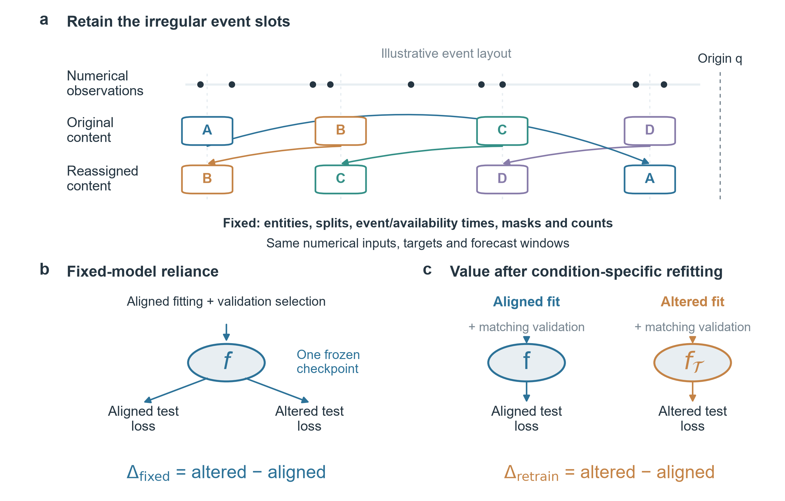

# PRISM

**Paired Reliance Interventions with Structured Matching**

Research artifact for **PRISM separates model reliance from context value in multimodal forecasting**.

**Authors:** Yanbo Bian and Zhihai Wang (corresponding author). The current manuscript targets *Information Fusion* and is a research draft. The repository and release do not imply journal submission or acceptance.

PRISM preserves forecast units and the observed event process while comparing fixed-model content reliance, cue-specific controls and information value after condition-specific retraining. Generated irregular controls discriminate direction from source cues. An independent photovoltaic ridge comparison gives 19.65% fixed-model alignment gain versus 8.97% after retraining. Interpretation remains conditional on the specified predictors, learning procedures and intervention laws.

[Manuscript PDF](artifacts/PRISM_InformationFusion_Extended.pdf) · [Editable LaTeX](artifacts/PRISM_InformationFusion_LaTeX_Source.zip) · [Figure assets](artifacts/PRISM_Figure_Assets.zip) · [Versioned release](https://github.com/bianyanbo44-afk/prism-multimodal-forecasting/releases/tag/v0.1.2)

[Reference audit, 13 October 2026](paper_rewriting_output/journal_extension_20261012/literature/REFERENCE_CHECK_20261013.md): all 40 bibliography records, including the 25 cited references, were found in fresh official sources. All 20 supplied DOIs resolve to the corresponding works. This update corrects one unused author spelling and normalizes one unused title symbol; the rendered manuscript is unchanged.



## Verify a complete training and selection example

Python 3.10 or later and NumPy are sufficient. Run from the repository root:

```sh
python -m pip install -r requirements-replay.txt
python verify_public_release.py --example-only
```

This verifies the committed file identities and refits the first generated direction world using its training features, validation-selected ridge penalty and independent test entities. It does not load a language model or original benchmark files.

## Replay all generated experiments

```sh
python verify_public_release.py --download
```

The command downloads `PRISM_Synthetic_Evidence.zip` from the versioned GitHub release, verifies each array against `SYNTHETIC_EVIDENCE_MANIFEST.json`, and reconstructs the saved calibration and construct predictions. All twenty worlds in each generated batch and all reported conditions are retained. Fitted linear states and paired generated-data losses are committed; the forty larger feature arrays are distributed as a release asset. `PUBLIC_REPLAY_RESULT.json` records numerical discrepancies and the executed scope.

## Code, figures and natural-data reconstruction

The original relative project layout is retained:

- `paper_rewriting_output/journal_extension_20261012/`: manuscript, eight figures, plotting code, evaluation runners, frozen configurations and aggregate results.
- `phase3_prototype/`: original project adapters, configurations, tests and historical validation summaries required by the reporting tables.
- `artifacts/`: the 32-page manuscript, editable source and figure package.
- `DATA_ACCESS.md`: upstream dataset/model routes and the boundary between public generated evidence and local natural-data replay.

From the repository root, saved tables can be regenerated with:

```sh
python paper_rewriting_output/journal_extension_20261012/scripts/assemble_result_tables.py --historical-root phase3_prototype
python paper_rewriting_output/journal_extension_20261012/scripts/assemble_construct_tables.py
python paper_rewriting_output/journal_extension_20261012/scripts/make_journal_figures.py
```

Plotting requires Matplotlib and the analysis dependencies. Compile `manuscript/main.tex` with `pdflatex`, `bibtex`, then two further `pdflatex` passes. Original experiment runners preserve their frozen execution paths for provenance; relocate only input/output paths in a new configuration, obtain the pinned upstream resources, and use a fresh output directory. The portable construct runner exposes these path overrides explicitly.

## Interpretation and citation

Generated cue discrimination is confined to the stated vocabulary and empirical timing templates. The construct validation bound follows same-sample penalty selection and is descriptive. Unscreened null detections of 15% and 10% remain reported. Natural irregular transfer is inconsistent, and photovoltaic report issuance/arrival times are unavailable. See the manuscript for the complete evidence and limitations.

See `CITATION.md` for the title, version and repository identifier. Authors are Yanbo Bian and Zhihai Wang; Zhihai Wang is the corresponding author. No DOI is assigned by this release. Public inspection is enabled; no blanket reuse licence has been assigned. Third-party providers retain their own terms, as recorded in `DATA_ACCESS.md` and `THIRD_PARTY_NOTICES.md`.

中文：这是 PRISM 的公开稿件、代码、生成实验与汇总证据仓库。原始 Time-IMM/Fidel 数据、自然数据设计矩阵、文本表示缓存、预训练权重和 384 MiB 本地评阅包不在公开发布范围。当前 PDF 已补齐 Yanbo Bian、Zhihai Wang 的署名、单位、邮箱和通讯标记，Zhihai Wang 为通讯作者；Information Fusion 官方采用单盲审稿。
